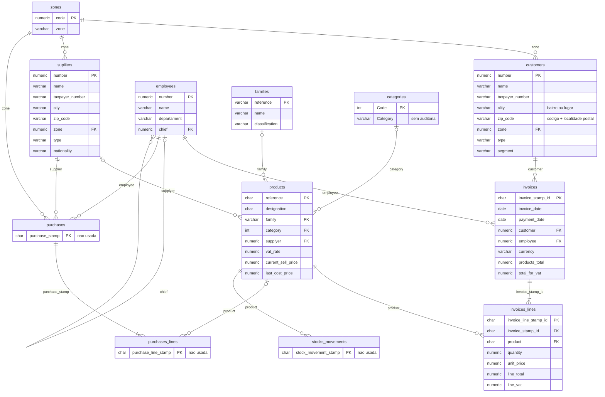
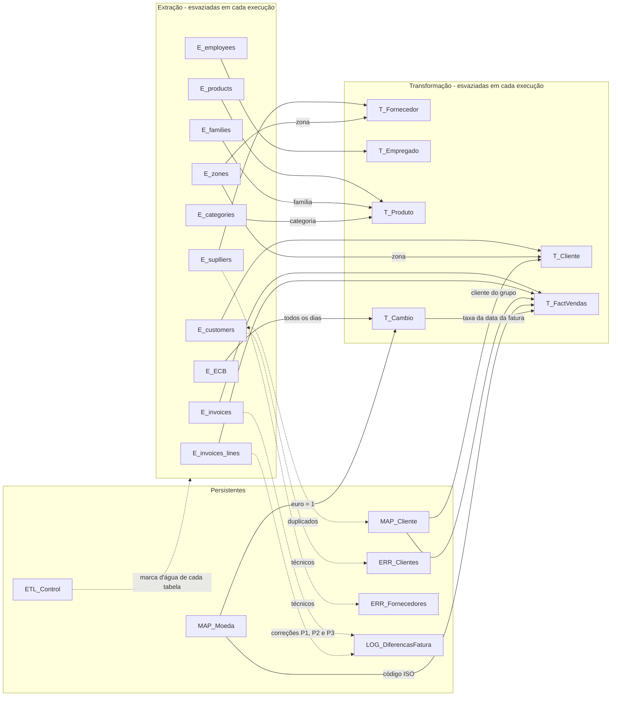
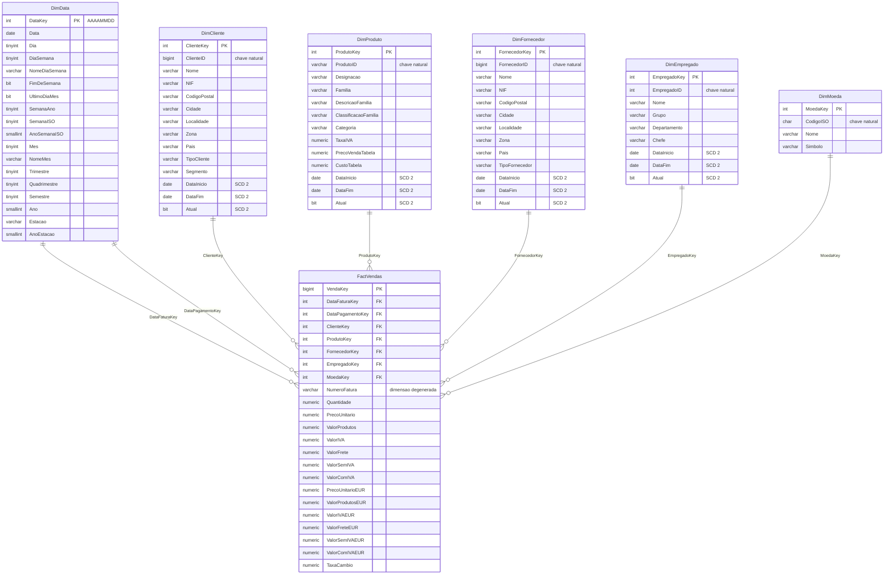

# Diagramas das bases de dados

Diagramas em Mermaid (o GitHub e o VS Code mostram-nos como figuras). Há três BDs:

| BD | Papel | Tabelas |
|---|---|---|
| `MoreRhythm` | Fonte (sistema operacional) | 12 tabelas, ligadas por chaves estrangeiras |
| `MoreRhythm_SA` | Staging area (capítulo 6) | 22 tabelas, sem chaves estrangeiras: as ligações são feitas pelo ETL |
| `MoreRhythm_DM` | Data mart (capítulo 5) | 6 dimensões + 1 tabela de factos, em estrela |

## 1. Visão geral do fluxo

Igual à Figura 1 do relatório.

```mermaid
---
config:
  layout: elk
---
flowchart LR
    subgraph FONTE["1 - Fontes de dados"]
        MR[("BD operacional<br/>MoreRhythm<br/>SQL Server 2025")]
        ECB["Taxas de câmbio do BCE<br/>ficheiro CSV"]
    end

    subgraph STG["2 - Staging area (MoreRhythm_SA)"]
        CTRL["ETL_Control<br/>data da última extração<br/>de cada tabela"]
        RAW["Extração: E_*<br/>dados como na fonte"]
        TR["Transformação: T_*<br/>limpos, deduplicados<br/>e integrados"]
        ERR["ERR_Clientes<br/>ERR_Fornecedores<br/>registos rejeitados"]
        LOG["LOG_DiferencasFatura"]
        MAP["MAP_Cliente<br/>MAP_Moeda"]
    end

    subgraph DM["3 - Data Mart (MoreRhythm_DM)"]
        SCR["Script SQL<br/>(DimData)"]
        DIM["Dimensões<br/>DimData, DimCliente,<br/>DimProduto, DimFornecedor,<br/>DimEmpregado, DimMoeda"]
        FACT["FactVendas<br/>grão: linha de fatura"]
    end

    subgraph APR["4 - Apresentação"]
        PBI["Power BI<br/>20 análises"]
    end

    MR -- "carga incremental" --> RAW
    ECB -- "ficheiro completo" --> RAW
    CTRL <-. "lê / atualiza" .-> RAW

    RAW -- "limpeza e transformação" --> TR
    RAW -. "não corrigíveis" .-> ERR
    RAW -. "correções P1, P2 e P3" .-> LOG
    MAP <-. "duplicados e moedas" .-> TR

    SCR -. "gerada uma vez" .-> DIM
    TR -- "1.º carga das dimensões<br/>(SCD e criação das SK)" --> DIM
    TR -- "2.º carga dos factos" --> FACT
    DIM -. "lookup das SK" .-> FACT

    FACT -- "só leitura" --> PBI
```

## 2. Fonte: MoreRhythm

Chaves estrangeiras definidas na BD da fonte. As tabelas de compras e de stocks não são usadas no data mart de vendas. Só aparecem as colunas usadas, mais as chaves.

Todas as tabelas, exceto `zones` e `categories`, têm as colunas de auditoria `create_date`, `create_time`, `last_update_date` e `last_update_time`.

## 3. Staging area: MoreRhythm_SA

A staging não tem chaves estrangeiras. O diagrama mostra que tabelas alimentam cada tabela de transformação e de que forma.

## 4. Data mart: MoreRhythm_DM

Estrela com a FactVendas ao centro. A DimData é usada duas vezes (role-playing). Todas as dimensões têm a linha -1 "Desconhecido".

## 5. Da fonte ao data mart, por tabela

| Data mart | Staging (transformação) | Fonte |
|---|---|---|
| DimData | (gerada por script) | - |
| DimCliente | `T_Cliente` + `MAP_Cliente` | `customers` + `zones` |
| DimProduto | `T_Produto` | `products` + `families` + `categories` |
| DimFornecedor | `T_Fornecedor` | `suplliers` + `zones` |
| DimEmpregado | `T_Empregado` | `employees` (chefe: a própria `employees`) |
| DimMoeda | `MAP_Moeda` | `invoices.currency` |
| FactVendas | `T_FactVendas` + `T_Cambio` | `invoices` + `invoices_lines` (+ `products.supplyer`) + CSV do BCE |