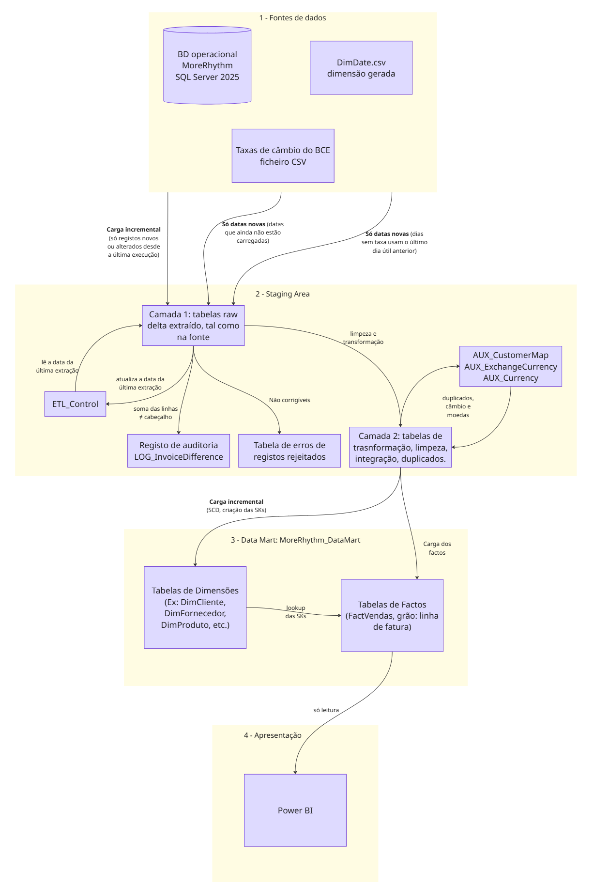

# RELATÓRIO TÉCNICO

Mestrado em Engenharia Informática

Armazéns de Dados (ARMDD)

Ano letivo 2026/2027

Trabalho Prático

Data Mart de Vendas da More Rhythm, SA

Desenvolvido por:

Ellah Fleischmann (1231478) e Raphael Moragas (1260464)

Porto, novembro de 2026

## Índice

- 1\. Introdução
    - 1.1 Contexto e objetivo
    - 1.2 Desafio
    - 1.3 Fonte dos dados
    - 1.4 Metodologia e ferramentas
    - 1.5 Estrutura do relatório
- 2\. Arquitetura do armazém de dados
    - 2.1 Fontes de dados
    - 2.2 Staging area
    - 2.3 Data Mart
    - 2.4 Camada de apresentação
    - 2.5 Processo de ETL e carga incremental
    - 2.6 Parametrização
    - 2.7 Repositório e organização do projeto
- 3\. Fonte de dados e data profiling
    - 3.1 Caracterização da fonte
    - 3.2 Regras de negócio inferidas
    - 3.3 Problemas de qualidade e tratamento
    - 3.4 Casos analisados e não tratados como problemas
- 4\. Análise dimensional
    - 4.1 Processo de negócio
    - 4.2 Grão
    - 4.3 Dimensões
    - 4.4 Factos
    - 4.5 Matriz de barramento
- 5\. Modelo dimensional
    - 5.1 Visão geral
    - 5.2 FactVendas
    - 5.3 DimData
    - 5.4 DimCliente
    - 5.5 DimProduto
    - 5.6 DimFornecedor
    - 5.7 DimEmpregado
    - 5.8 DimMoeda
    - 5.9 Tipos de dados

## 1. Introdução

Este relatório apresenta a primeira parte do trabalho prático da unidade curricular de Armazéns de Dados (ARMDD), integrada no Mestrado em Engenharia Informática, no ano letivo 2026/2027. 

O projeto tem como objetivo desenvolver um Data Mart com base nos dados de vendas e faturação da More Rhythm, SA, uma empresa dedicada à distribuição e comercialização de instrumentos musicais, com sede no Porto.

Nesta primeira fase, o trabalho centra-se na análise e no desenho da solução, incluindo a definição da arquitetura do armazém de dados, a construção do modelo dimensional, a identificação das estruturas de dados da *staging area* e a definição dos respetivos mapeamentos. A fase de implementação será desenvolvida na segunda parte do projeto, contemplando os processos de extração, transformação, limpeza e carregamento dos dados (Extract, Transform, Load - ETL).

### 1.1 Contexto e objetivos

A More Rhythm, SA, apresentada anteriormente, é uma empresa de referência a nível nacional na distribuição e comercialização de instrumentos musicais, com sede no Porto. A sua atividade comercial abrange todo o território nacional e, pontualmente, Espanha. O sistema informático da empresa dá suporte às principais atividades operacionais, nomeadamente às vendas e faturação, às compras e à gestão de stocks.

A administração da empresa pretende implementar um Data Mart que permita analisar, de forma histórica, as vendas realizadas aos seus clientes. Para garantir flexibilidade nas análises, o Data Mart deverá permitir a consultaa ao nível de granularidade mais elementar, assim como indicado no enunciado do projeto. 

Além disso, a solução deverá acompanhar a evolução prevista da empresa, que pretende expandir a sua atividade para outros países da União Europeia e abrir a sua primeira sucursal no estrangeiro, no Reino Unido.

### 1.2 Desafios

Os dados do sistema operacional, em conjunto com os requisitos definidos pela empresa, apresentam vários desafios para o desenvolvimento do Data Mart:

- **Registos duplicados**. O processo de limpeza dos dados deverá identificar e eliminar situações de duplicação, incluindo registos exatamente iguais e registos com pequenas diferenças. Um exemplo identificado no enunciado é o dos clientes, uma vez que o mesmo cliente pode estar registado com identificadores diferentes, sem que os respetivos registos sejam necessariamente iguais.
- **Qualidade dos dados**. Podem existir valores em falta em atributos de preenchimento obrigatório, valores que não respeitam os domínios definidos ou violações das restrições de integridade. Os registos cuja correção não possa ser realizada de forma automática não deverão ser carregados no Data Mart, devendo ser armazenados em tabelas de erros na *staging area*.
- **Custos de expedição**. Atualmente, estes custos estão associados à fatura e não às respetivas linhas ou produtos, o que representa um desafio na sua distri buição e análise ao nível de detalhe pretendido.
- **Várias moedas**. Atualmente, todas as vendas são faturadas em euros. No entanto, a fatura expansão para o Reino Unido implicará a utilização de outra moeda. Assim, para permitir a comparação e aálise de vendas realizadas em diferentes moedas, será necessário uniformizar os valores através da conversão para euros.
- **Carga incremental**. O sistema operacional regista a data e a hora de inserção e de alteração de cada registo. Esta informação deverá ser utilizada para implementar um processo de carga incremental das dimensões e dos factos, garantindo que, em cada execução, apenas são carregados os novos registos e atualizados aqueles que sofretam alterações.
- **Volume e eficiência**. Embora a amostra de dados disponibilizada seja reduzida, representa um cenário real em que o volume de registos será consideravelmente superior. Por esse motivo, os processos de ETL deverão ser concebidos de forma a garantir a maior eficiência possível, mesmo perante grandes volumes de dados.
- **Parametrização**. O projeto de Integration Services não deverá utilizar caminhos absolutos. Todos os caminhos, nomes dos servidores e nomes das bases de dados deverão ser definidos num ficheiro de parametrizações, permitindo adaptar a configuração do projeto a diferentes ambientes sem necessidade de alterar os processos de ETL.

### 1.3 Fonte dos dados

A fonte dos dados utilizada é a base de dados operacional MoreRhythm, desenvolvida em Microsoft SQL Server 2025 e disponibilizada como uma amostra dos dados reais (ficheiros MoreRhythm.mdf e MoreRhythm_log.ldf). 

A base de dados e constituída por 12 tabelas, que abrangem três processos de negócio: vendas (*invoices* e *invoices_lines*), compras (*purchases* e *purchases_lines*) e movimentos de stock (*stocks_movements*). As restantes sete tabelas contêm os dados mestre relativos a clientes, fornecedores, funcionários, produtos, famílias, categorias e zonas. 

A amostra disponibilizada inclui 37 faturas, correspondentes a um total de 93 linhas, emitidas entre 31 de janeiro e 1 de maio de 2025.

Antes de avançar com o desenho do Data Mart, foi realizado um processo de *data profiling* sobre a amostra. Esta análise permitiu compreender melhor a estrutura dos dados, identificar algumas regras de negócio refletidas na informação e detetar problemas de qualidade que terão de ser tratados ao longo do projeto. Estes problemas serão apresentados com maior detalhe capítulo 3.

### 1.4 Metodologia e ferramentas

O desenho do Data Mart seguirá a metodologia de Kimball, conforme definido no enunciado do proejto. A análise dimensional será desenvolvida de acordo com os quatro passos desta metodologia: selecionar o processo de negócio, declarar o grão, identificar as dimensões e identificar os factos. As decisões tomadas ao longo da construção do modelo dimensional serão devidamente justificadas nas respetivas secções deste relatório.

Para o desenvolvimento do projeto, serão utilizadas as seguintes ferramentas:

- **Microsoft SQL Server**: utilizado para alojar a base de dados fonte, a *staging area* e o Data Mart, sendo que estas duas últimas estruturas ficarão alojadas no mesmo servidor.
- **SQL Server Integration Services (SSIS)**: integrado num projeto de Integration Services Project desenvolvido no Visual Studio, será utilizado para implementar os processos de ETL.
- **Power BI**: utilizado para desenvolver as 20 análises multidimensionais previstas para o projeto, das quais 10 foram definidas pela gestão da empresa e as restantes 10 serão propostas pelo grupo. Estas análises terão diferentes níveis de complexidade e irão explorar as hierarquias definidas no modelo dimensional.
- **GitHub**: utilizado para gerir e partilhar o trabalho desenvolvido pelas dois elementos do grupo, através do repositório ARMDD_26-27_1231478_1260464, onde serão disponibilizados a documentação e o projeto SSIS.

### 1.5 Estrutura do relatório

O relatório encontra-se organizado em oito capítulos, cada um dedicado a uma componente do desenvolvimento do projeto:

- **Capítulo 2**: apresenta a arquitetura do armazém de dados, desde a fonte de informação até à sua disponibilização no Power BI.
- **Capítulo 3**: caracteriza a base de dados de origem e descreve os resultados obtidos através do processo de *data profiling*.
- **Capítulo 4**: aborda a análise dimensional, seguindo os quatro passos da metodologia de Kimball.
- **Capítulo 5**: descreve o modelo dimensional, incluindo os atributos e respetivos tipos de dados da tabela de factos e de cada dimensão.
- **Capítulo 6**: define as estruturas de dados da *staging area*, nomeadamente as tabelas e os fihceiros utilizados.
- **Capítulo 7**: apresenta os mapeamentos de dados entre a fonte e a *staging area*, bem como entre esta última e o Data Mart. Inclui ainda a estratégia de *Slowly Changin Dimensions* (SCD) e as transformações e operações de limpeza aplicadas a cada atributo.
- **Capítulo 8** encerra o relatório com as conclusões do trabalho, as limitações identificadas e as possíveis melhorias futuras.

## 2. Arquitetura do armazém de dados

A arquitetura do armazém de dados está organizada em quatro camadas: fontes de dados,*staging area*, Data Mart e camada de apresentação. A transferência de dados entre estas camadas é relizada através de processos de ETL, desenvolvidos em SQL Server Integrations Services (SSIS). Todas as bases de dados utilizadas no projeto, estão alojadas em Microsoft SQL Server 2025. 
Figura 1 – Arquitetura do armazém de dados da More Rhythm

### 2.1 Fontes de dados

A principal fonte de dados é a base de dados operacional MoreRhythm. Das suas 12 tabelas são utilizadas apenas as 9 relacionadas com o processo de vendas (*invoices*, *invoices_lines*, *customers*, *employees*, *products*, *families*, *categories*, *suplliers* e *zones*). As tabelas relativas às compras e aos movimentos de stock ficam fora do âmbito deste projeto, uma vez que correspondem a outros processos de negócio que não serão realizados nesta fase.

Uma vez que a base de dados operacional não contém taxas de câmbio e que o euro será utilizado como moeda de referência para as análises, foi necessário recorrer a uma fonte externa. Para esse efeito, foram utilizadas as taxas de câmbio disponibiliadas pelo Banco Central Europeu (BCE), obtidas a 2 de novembro de 2026, através do site https://data.ecb.europa.eu/data/datasets/EXR/EXR.D.GBP.EUR.SP00.A. 

Foi descarregada a série de conversão diária da libra esterlina (GBP) para euro (EUR), sendo os dados guardados no fihciero ECB Data EUR GBP.csv (BD\ECB Data EUR GBP.csv). Este ficheiro contém a data, a respetiva representação por extenso e a taxa de câmbio. A taxa indica quantas libras correspondem a um euro, pelo que, para converter um valor de libras para euros, é necessário dividi-lo pela taxa de câmbio correspondente à data da fatura. No caso do euro, a taxada de conversão é sempre igual a 1, pelo que não é necessário incluí-lo no ficheiro.

Uma vez que o BCE apenas disponibiliza taxas de câmbio para os dias úteis, nos fins de semana e feriados será utilizada a taxa de câmbio do último dia últil anterior. As observações, correspondentes a feriados, nomeadamente os registos existentes até 2012, são ignoradas.

A terceira fonte de dados é o ficheiro DimDate.csv, gerado uma única vez, seguindo o procedimento utilizado nos exercícios das aulas. Para além dos atributos habituais de calendário, como o dia, o mês, o trimestre, o semestre e o ano, inclui também a semana segundo o padrão do SQL Server e a semana segundo a norma ISO 8601, acompanhada do respetivo ano ISO. Contém ainda informação sobre a estação meteorológica, o quadrimestre e indicadores que identificam o último dia do mês e os fins de semana. 

O intervalor de datas abrangido contempla as datas das faturas e dos respetivos pagamentos, bem como alguns anos futuros, de forma a permitir a utilização da dimensão temporal em análises posteriores.

Os ficheiros externos utilizados no projeto ficam armazenados na pasta Files do projeto, cuja a localização é apresentada na secção 2.7.

### 2.2 Staging area

A *staging area* corresponde à base de dados MoreRhythm_StagingArea, alojada no mesmo servidor que o Data Mart. Esta organização permite que o sistema operacional seja consultado apenas uma vez por execução, ficando todo o tratamento dos dados a cargo da *staging area*. A sua estrutura está dividida em duas camadas de dados e dois grupos de tabelas de apoio.

A primeira camada (RAW_) recebe os dados diretamente da fonte, mantendo os tipos de dados e as colunas de auditoria originais. A segunda camada (TR_) armazena os dados após os processos de limpeza, deduplicação e integração, ficando preparados para serem carregados no Data Mart.

As duas camadas contêm apenas os registos correspondentes à carga incremental de cada execução, sendo esvaziadas no início de cada processo de ETL. Por outro lado, as tabelas de erros (ERR_) armazenam os registos cuja correção não é possível realizar automaticamente, juntamente com o respetivo motivo e a data da execução. Ao contrário das duas primeiras camadas, estas tabelas mantêm os erros acumulados ao longo de todas as execuções.

Esta separação permite comparar os dados originais com os dados após o tratamento, facilitando a identificação das alterações efetuadas e dos motivos que levaram à rejeição de determinados registos.

As tabelas auxiliares são persistentes e desempenham diferentes funções no processo de ETL:
- **ETL_Control**: armazena a marca de água (watermark) de cada tabela, correspondente à data e hora do registo mais recente extraído com sucesso (secção 2.5).
- **AUX_CustomerMap**: mantém a correspondência entre cada cliente e o respetivo grupo de duplicados. Esta tabela é necessária porque as camadas RAW_ e TR_ contêm apenas os registos da carga incremental. Assim, quando surge um novo cliente, é possível compará-lo também com os clientes já carregados em execuções anteriores.
- **AUX_ExchangeRate**: armazena as taxas de câmbio de cada moeda para todos os dias abrangidos pelo calendário.
- **AUX_Currency**: contém a lista de moedas utilizadas e os respetivos mapeamentos, incluindo a correspondência entre «EURO» e «EUR»
- **LOG_InvoiceDifference**: regista as faturas em que a soma dos valores das linhas apresenta diferenças em relação aos valores do cabeçalho.

As estruturas e os atributos de cada uma destas tabelas são apresentados com maior detalhe no capítulo 6.

### 2.3 Data Mart

O Data Mart corresponde à base de dados MoreRhythm_DataMart e segue a metodologia de Kimball, sendo constituído por várias dimensões e por uma tabela de factos de vendas, cujo grão corresponde à linha de fatura (capítulos 4 e 5).

Apenas os processos de ETL têm permissões de escrita no Data Mart. Os utilizadores e o Power BI acedem aos dados exclusivamente para consulta, garantindo assim que as alterações aos dados são controladas pelos processos de carregamento.

### 2.4 Camada de apresentação

A camada de apresentação é assegurada pelo Power BI, que estabelece ligação exclusivamente ao Data Mart. É nesta ferramenta que serão desenvolvidas as 20 análises multidimensionais previstas para o projeto, permitindo explorar os dados através das operações de drill down e roll up ao longo das hierarquias definidas no modelo dimensional.

### 2.5 Processo de ETL e carga incremental

De acordo com os requisitos do enunciado, o processo de ETL segue uma estratégia de carga incremental. Em cada execução, é consultada a tabela ETL_Control para obter a marca d'água (*watermark*) de cada tabela. Com base nessa informação, são extraídos apenas os registos que foram inseridos ou alterados após a última extração bem-sucedida.

Uma vez que a data e a hora de criação e de alteração estão armazenadas em colunas separadas na fonte, estes valores são combinados para obter uma única referência temporal. Para determinar a data de referência de cada registo, é utilizado o maior valor entre a data de criação e a data de alteração. Esta abordagem é necessária porque foram identificados 8 fornecedores e 8 produtos cuja data de alteração é anterior à data de criação. As tabelas zones e categories não possuem colunas de auditoria, pelo que são extraídas na sua totalidade em cada execução. O mesmo acontece com os ficheiros externos, embora, neste caso, apenas sejam inseridas as datas que ainda não existem na respetiva estrutura.

No caso das faturas, alguns dos atributos necessários ao modelo dimensional, como o cliente, o empregado, as datas, a moeda e o custo de expedição (frete), encontram-se no cabeçalho da fatura, enquanto o grão definido corresponde à linha de fatura. Por esse motivo, são extraídas as linhas cuja própria data de alteração, ou a do respetivo cabeçalho, seja posterior à marca de água. Sempre que um cabeçalho sofre alterações, todas as linhas associadas à respetiva fatura são novamente processadas.

Esta abordagem é particularmente importante, uma vez que 36 das 37 faturas da amostra foram alteradas após a sua criação, tendo sido identificados intervalos de até 334 dias entre os dois momentos. Além disso, é necessário garantir que as alterações nos atributos desnormalizados são refletidas nas tabelas correspondentes do Data Mart. Por exemplo, uma alteração numa família, categoria, zona ou no nome de um chefe implica o reprocessamento dos produtos, clientes, fornecedores ou funcionários afetados, respetivamente.

O carregamento das dimensões é realizado antes do carregamento da tabela de factos, respeitando a estratégia de *Slowly Changing Dimensions* (SCD) definida para cada atributo. Durante o carregamento dos factos, as chaves naturais são substituídas pelas respetivas chaves substitutas (*surrogate keys*), tendo em conta a versão válida de cada dimensão na data da fatura.

Para garantir a consistência dos dados, as linhas de cada fatura alterada são eliminadas e novamente inseridas no Data Mart. Desta forma, são também contempladas situações em que tenham sido acrescentadas ou eliminadas linhas de uma fatura. A identificação de cada fatura é feita através do valor completo de *invoice_stamp_id*, uma vez que o prefixo anterior à vírgula não é único.

No final de cada execução bem-sucedida, a marca de água é atualizada na tabela ETL_Control. Caso ocorra uma falha durante o processo, a marca de água não é atualizada, permitindo que, na execução seguinte, os mesmos registos sejam novamente extraídos e processados.

A estrutura da tabela ETL_Control é apresentada na Tabela 1. O atributo LastExtractedAt utiliza o tipo de dados datetime2(7), garantindo a mesma precisão das colunas time(7) existentes na base de dados de origem e evitando que algum registo seja ignorado devido a arredondamento.

Tabela 1 – Estrutura da tabela ETL_Control

| Coluna | Tipo | Descrição |
| --- | --- | --- |
| TableName | varchar(50) | Nome da tabela fonte (chave primária) |
| LastExtractedAt | datetime2(7) | Maior data e hora de criação ou de alteração extraída com sucesso (marca d'água) |
| LastRunAt | datetime2(0) | Data e hora da última execução bem-sucedida |
| RowsExtracted | int | Número de registos extraídos nessa execução |

### 2.6 Parametrização

Para evitar a utilização de caminhos absolutos, a configuração do projeto é definida através dos parâmetros do projeto SSIS (Project.params), seguindo a abordagem utilizada nos exercícios das aulas (Tabela 2).

As ligações às bases de dados e os caminhos dos ficheiros são definidos através de expressões que recorrem a estes parâmetros. Por exemplo, o caminho para o ficheiro das taxas de câmbio é construído através da expressão @[$Project::PackagePath] + "\\Files\\ECB Data EUR GBP.csv".

Desta forma, para executar o projeto noutro computador ou ambiente, basta atualizar os valores dos parâmetros, sem necessidade de alterar os pacotes ou as respetivas expressões. Foram também acrescentados os parâmetros relativos ao servidor e à base de dados de origem, de acordo com os requisitos do enunciado.

Tabela 2 – Parâmetros do projeto SSIS

| Parâmetro | Tipo | Valor de exemplo | Utilização |
| --- | --- | --- | --- |
| SourceServerName | String | (local) | Servidor da base de dados operacional |
| SourceDBName | String | MoreRhythm | Nome da base de dados operacional |
| ServerName | String | (local) | Servidor do Data Mart e da staging area (o mesmo para ambos) |
| StagingAreaDBName | String | MoreRhythm_StagingArea | Nome da base de dados da staging area |
| DataMartDBName | String | MoreRhythm_DataMart | Nome da base de dados do Data Mart |
| PackagePath | String | C:\ARMDD\MoreRhythm | Pasta do projeto, onde estão as pastas Files e SQL Scripts |

### 2.7 Repositório e organização do projeto

O projeto é desenvolvido e mantido no repositório GitHub ARMDD_26-27_1231478_1260464, onde estão reunidos todos os ficheiros necessários ao seu desenvolvimento.

A pasta principal do projeto, identificada pelo parâmetro PackagePath, está organizada em quatro subpastas, cada uma com uma finalidade específica:

- **Files**: contém os ficheiros externos utilizados no processo de ETL.
- **SQL Scripts**: reúne os scripts SQL utilizados para a criação das tabelas.
- **MoreRhythm ETL**: contém o projeto SSIS e os respetivos pacotes de ETL.
- **Docs**: reúne a documentação do projeto, incluindo os relatórios, os resultados do data profiling e o registo das decisões tomadas ao longo do desenvolvimento.