# RELATÓRIO TÉCNICO

Mestrado em Engenharia Informática

Armazéns de Dados (ARMDD)

Ano letivo 2026/2027

Trabalho Prático

Data Mart de Vendas da More Rhythm, SA

Desenvolvido por:

Ellah Fleischmann (1231478) e Raphael Moragas (1260464)

Porto, novembro de 2026

## Índice

- 1\. Introdução
    - 1.1 Contexto e objetivo
    - 1.2 Desafio
    - 1.3 Fonte dos dados
    - 1.4 Metodologia e ferramentas
    - 1.5 Estrutura do relatório
- 2\. Arquitetura do armazém de dados
    - 2.1 Fontes de dados
    - 2.2 Staging area
    - 2.3 Data Mart
    - 2.4 Camada de apresentação
    - 2.5 Processo de ETL e carga incremental
    - 2.6 Parametrização
    - 2.7 Repositório e organização do projeto
- 3\. Fonte de dados e data profiling
    - 3.1 Caracterização da fonte
    - 3.2 Regras de negócio inferidas
    - 3.3 Problemas de qualidade e tratamento
    - 3.4 Casos analisados e não tratados como problemas
- 4\. Análise dimensional
    - 4.1 Processo de negócio
    - 4.2 Grão
    - 4.3 Dimensões
    - 4.4 Factos
    - 4.5 Matriz de barramento
- 5\. Modelo dimensional
    - 5.1 Visão geral
    - 5.2 FactVendas
    - 5.3 DimData
    - 5.4 DimCliente
    - 5.5 DimProduto
    - 5.6 DimFornecedor
    - 5.7 DimEmpregado
    - 5.8 DimMoeda
    - 5.9 Tipos de dados

## 1. Introdução

Este relatório apresenta a primeira parte do trabalho prático da unidade curricular de Armazéns de Dados (ARMDD), integrada no Mestrado em Engenharia Informática, no ano letivo 2026/2027. 

O projeto tem como objetivo desenvolver um Data Mart com base nos dados de vendas e faturação da More Rhythm, SA, uma empresa dedicada à distribuição e comercialização de instrumentos musicais, com sede no Porto.

Nesta primeira fase, o trabalho centra-se na análise e no desenho da solução, incluindo a definição da arquitetura do armazém de dados, a construção do modelo dimensional, a identificação das estruturas de dados da *staging area* e a definição dos respetivos mapeamentos. A fase de implementação será desenvolvida na segunda parte do projeto, contemplando os processos de extração, transformação, limpeza e carregamento dos dados (Extract, Transform, Load - ETL).

### 1.1 Contexto e objetivos

A More Rhythm, SA, apresentada anteriormente, é uma empresa de referência a nível nacional na distribuição e comercialização de instrumentos musicais, com sede no Porto. A sua atividade comercial abrange todo o território nacional e, pontualmente, Espanha. O sistema informático da empresa dá suporte às principais atividades operacionais, nomeadamente às vendas e faturação, às compras e à gestão de stocks.

A administração da empresa pretende implementar um Data Mart que permita analisar, de forma histórica, as vendas realizadas aos seus clientes. Para garantir flexibilidade nas análises, o Data Mart deverá permitir a consultaa ao nível de granularidade mais elementar, assim como indicado no enunciado do projeto. 

Além disso, a solução deverá acompanhar a evolução prevista da empresa, que pretende expandir a sua atividade para outros países da União Europeia e abrir a sua primeira sucursal no estrangeiro, no Reino Unido.

### 1.2 Desafios

Os dados do sistema operacional, em conjunto com os requisitos definidos pela empresa, apresentam vários desafios para o desenvolvimento do Data Mart:

- **Registos duplicados**. O processo de limpeza dos dados deverá identificar e eliminar situações de duplicação, incluindo registos exatamente iguais e registos com pequenas diferenças. Um exemplo identificado no enunciado é o dos clientes, uma vez que o mesmo cliente pode estar registado com identificadores diferentes, sem que os respetivos registos sejam necessariamente iguais.
- **Qualidade dos dados**. Podem existir valores em falta em atributos de preenchimento obrigatório, valores que não respeitam os domínios definidos ou violações das restrições de integridade. Os registos cuja correção não possa ser realizada de forma automática não deverão ser carregados no Data Mart, devendo ser armazenados em tabelas de erros na *staging area*.
- **Custos de expedição**. Atualmente, estes custos estão associados à fatura e não às respetivas linhas ou produtos, o que representa um desafio na sua distri buição e análise ao nível de detalhe pretendido.
- **Várias moedas**. Atualmente, todas as vendas são faturadas em euros. No entanto, a fatura expansão para o Reino Unido implicará a utilização de outra moeda. Assim, para permitir a comparação e aálise de vendas realizadas em diferentes moedas, será necessário uniformizar os valores através da conversão para euros.
- **Carga incremental**. O sistema operacional regista a data e a hora de inserção e de alteração de cada registo. Esta informação deverá ser utilizada para implementar um processo de carga incremental das dimensões e dos factos, garantindo que, em cada execução, apenas são carregados os novos registos e atualizados aqueles que sofretam alterações.
- **Volume e eficiência**. Embora a amostra de dados disponibilizada seja reduzida, representa um cenário real em que o volume de registos será consideravelmente superior. Por esse motivo, os processos de ETL deverão ser concebidos de forma a garantir a maior eficiência possível, mesmo perante grandes volumes de dados.
- **Parametrização**. O projeto de Integration Services não deverá utilizar caminhos absolutos. Todos os caminhos, nomes dos servidores e nomes das bases de dados deverão ser definidos num ficheiro de parametrizações, permitindo adaptar a configuração do projeto a diferentes ambientes sem necessidade de alterar os processos de ETL.

### 1.3 Fonte dos dados

A fonte dos dados utilizada é a base de dados operacional MoreRhythm, desenvolvida em Microsoft SQL Server 2025 e disponibilizada como uma amostra dos dados reais (ficheiros MoreRhythm.mdf e MoreRhythm_log.ldf). 

A base de dados e constituída por 12 tabelas, que abrangem três processos de negócio: vendas (*invoices* e *invoices_lines*), compras (*purchases* e *purchases_lines*) e movimentos de stock (*stocks_movements*). As restantes sete tabelas contêm os dados mestre relativos a clientes, fornecedores, funcionários, produtos, famílias, categorias e zonas. 

A amostra disponibilizada inclui 37 faturas, correspondentes a um total de 93 linhas, emitidas entre 31 de janeiro e 1 de maio de 2025.

Antes de avançar com o desenho do Data Mart, foi realizado um processo de *data profiling* sobre a amostra. Esta análise permitiu compreender melhor a estrutura dos dados, identificar algumas regras de negócio refletidas na informação e detetar problemas de qualidade que terão de ser tratados ao longo do projeto. Estes problemas serão apresentados com maior detalhe capítulo 3.

### 1.4 Metodologia e ferramentas

O desenho do Data Mart seguirá a metodologia de Kimball, conforme definido no enunciado do proejto. A análise dimensional será desenvolvida de acordo com os quatro passos desta metodologia: selecionar o processo de negócio, declarar o grão, identificar as dimensões e identificar os factos. As decisões tomadas ao longo da construção do modelo dimensional serão devidamente justificadas nas respetivas secções deste relatório.

Para o desenvolvimento do projeto, serão utilizadas as seguintes ferramentas:

- **Microsoft SQL Server**: utilizado para alojar a base de dados fonte, a *staging area* e o Data Mart, sendo que estas duas últimas estruturas ficarão alojadas no mesmo servidor.
- **SQL Server Integration Services (SSIS)**: integrado num projeto de Integration Services Project desenvolvido no Visual Studio, será utilizado para implementar os processos de ETL.
- **Power BI**: utilizado para desenvolver as 20 análises multidimensionais previstas para o projeto, das quais 10 foram definidas pela gestão da empresa e as restantes 10 serão propostas pelo grupo. Estas análises terão diferentes níveis de complexidade e irão explorar as hierarquias definidas no modelo dimensional.
- **GitHub**: utilizado para gerir e partilhar o trabalho desenvolvido pelas dois elementos do grupo, através do repositório ARMDD_26-27_1231478_1260464, onde serão disponibilizados a documentação e o projeto SSIS.

### 1.5 Estrutura do relatório

O relatório encontra-se organizado em oito capítulos, cada um dedicado a uma componente do desenvolvimento do projeto:

- **Capítulo 2**: apresenta a arquitetura do armazém de dados, desde a fonte de informação até à sua disponibilização no Power BI.
- **Capítulo 3**: caracteriza a base de dados de origem e descreve os resultados obtidos através do processo de *data profiling*.
- **Capítulo 4**: aborda a análise dimensional, seguindo os quatro passos da metodologia de Kimball.
- **Capítulo 5**: descreve o modelo dimensional, incluindo os atributos e respetivos tipos de dados da tabela de factos e de cada dimensão.
- **Capítulo 6**: define as estruturas de dados da *staging area*, nomeadamente as tabelas e os fihceiros utilizados.
- **Capítulo 7**: apresenta os mapeamentos de dados entre a fonte e a *staging area*, bem como entre esta última e o Data Mart. Inclui ainda a estratégia de *Slowly Changin Dimensions* (SCD) e as transformações e operações de limpeza aplicadas a cada atributo.
- **Capítulo 8** encerra o relatório com as conclusões do trabalho, as limitações identificadas e as possíveis melhorias futuras.

## 2. Arquitetura do armazém de dados

A arquitetura do armazém de dados está organizada em quatro camadas: fontes de dados,*staging area*, Data Mart e camada de apresentação. A transferência de dados entre estas camadas é relizada através de processos de ETL, desenvolvidos em SQL Server Integrations Services (SSIS). Todas as bases de dados utilizadas no projeto, estão alojadas em Microsoft SQL Server 2025. 
Figura 1 – Arquitetura do armazém de dados da More Rhythm

### 2.1 Fontes de dados

A principal fonte de dados é a base de dados operacional MoreRhythm. Das suas 12 tabelas são utilizadas apenas as 9 relacionadas com o processo de vendas (*invoices*, *invoices_lines*, *customers*, *employees*, *products*, *families*, *categories*, *suplliers* e *zones*). As tabelas relativas às compras e aos movimentos de stock ficam fora do âmbito deste projeto, uma vez que correspondem a outros processos de negócio que não serão realizados nesta fase.

Uma vez que a base de dados operacional não contém taxas de câmbio e que o euro será utilizado como moeda de referência para as análises, foi necessário recorrer a uma fonte externa. Para esse efeito, foram utilizadas as taxas de câmbio disponibiliadas pelo Banco Central Europeu (BCE), obtidas a 2 de novembro de 2026, através do site https://data.ecb.europa.eu/data/datasets/EXR/EXR.D.GBP.EUR.SP00.A. 

Foi descarregada a série de conversão diária da libra esterlina (GBP) para euro (EUR), sendo os dados guardados no fihciero ECB Data EUR GBP.csv (BD\ECB Data EUR GBP.csv). Este ficheiro contém a data, a respetiva representação por extenso e a taxa de câmbio. A taxa indica quantas libras correspondem a um euro, pelo que, para converter um valor de libras para euros, é necessário dividi-lo pela taxa de câmbio correspondente à data da fatura. No caso do euro, a taxada de conversão é sempre igual a 1, pelo que não é necessário incluí-lo no ficheiro.

Uma vez que o BCE apenas disponibiliza taxas de câmbio para os dias úteis, nos fins de semana e feriados será utilizada a taxa de câmbio do último dia últil anterior. As observações, correspondentes a feriados, nomeadamente os registos existentes até 2012, são ignoradas.

O intervalor de datas abrangido contempla as datas das faturas e dos respetivos pagamentos, bem como alguns anos futuros, de forma a permitir a utilização da dimensão temporal em análises posteriores.

Os ficheiros externos utilizados no projeto ficam armazenados na pasta Files do projeto, cuja a localização é apresentada na secção 2.7.

### 2.2 Staging area

A *staging area* corresponde à base de dados MoreRhythm_SA, alojada no mesmo servidor que o Data Mart. Esta organização permite que o sistema operacional seja consultado apenas uma vez por execução, ficando todo o tratamento dos dados a cargo da *staging area*. A sua estrutura está dividida em duas camadas de dados e dois grupos de tabelas de apoio.

A primeira camada (E_) recebe os dados diretamente da fonte, mantendo os tipos de dados e as colunas de auditoria originais. A segunda camada (T_) armazena os dados após os processos de limpeza, deduplicação e integração, ficando preparados para serem carregados no Data Mart.

As duas camadas contêm apenas os registos correspondentes à carga incremental de cada execução, sendo esvaziadas no início de cada processo de ETL. Por outro lado, as tabelas de erros (ERR_) armazenam os registos cuja correção não é possível realizar automaticamente, juntamente com o respetivo motivo e a data da execução. Ao contrário das duas primeiras camadas, estas tabelas mantêm os erros acumulados ao longo de todas as execuções.

Esta separação permite comparar os dados originais com os dados após o tratamento, facilitando a identificação das alterações efetuadas e dos motivos que levaram à rejeição de determinados registos.

As tabelas auxiliares são persistentes e desempenham diferentes funções no processo de ETL:
- **ETL_Control**: armazena a marca de água (watermark) de cada tabela, correspondente à data e hora do registo mais recente extraído com sucesso (secção 2.5).
- **MAP_Cliente**: mantém a correspondência entre cada cliente e o respetivo grupo de duplicados. Esta tabela é necessária porque as camadas E_ e T_ contêm apenas os registos da carga incremental. Assim, quando surge um novo cliente, é possível compará-lo também com os clientes já carregados em execuções anteriores.
- **T_Cambio**: armazena as taxas de câmbio de cada moeda para todos os dias abrangidos pelo calendário.
- **MAP_Moeda**: contém a lista de moedas utilizadas e os respetivos mapeamentos, incluindo a correspondência entre «EURO» e «EUR»
- **LOG_DiferencasFatura**: regista as correções feitas automaticamente aos valores das faturas: as linhas com o sinal trocado (P1), as faturas em que a soma das linhas difere do cabeçalho (P2) e os fretes recalculados (P3).

As estruturas e os atributos de cada uma destas tabelas são apresentados com maior detalhe no capítulo 6.

### 2.3 Data Mart

O Data Mart corresponde à base de dados MoreRhythm_DM e segue a metodologia de Kimball, sendo constituído por várias dimensões e por uma tabela de factos de vendas, cujo grão corresponde à linha de fatura (capítulos 4 e 5). 

A DimData é a única dimensão que não é carregada a partir da staging area: é gerada uma única vez por um script SQL, diretamente no Data Mart, com todas as datas de 2020-01-01 a 2035-12-31. Para além dos atributos habituais de calendário, como o dia, o mês, o trimestre, o semestre e o ano, inclui também a semana segundo o padrão do SQL Server e a semana segundo a norma ISO 8601, acompanhada do respetivo ano ISO. Contém ainda informação sobre a estação meteorológica, o quadrimestre e indicadores que identificam o último dia do mês e os fins de semana.

Apenas os processos de ETL têm permissões de escrita no Data Mart. Os utilizadores e o Power BI acedem aos dados exclusivamente para consulta, garantindo assim que as alterações aos dados são controladas pelos processos de carregamento.

### 2.4 Camada de apresentação

A camada de apresentação é assegurada pelo Power BI, que estabelece ligação exclusivamente ao Data Mart. É nesta ferramenta que serão desenvolvidas as 20 análises multidimensionais previstas para o projeto, permitindo explorar os dados através das operações de drill down e roll up ao longo das hierarquias definidas no modelo dimensional.

### 2.5 Processo de ETL e carga incremental

De acordo com os requisitos do enunciado, o processo de ETL segue uma estratégia de carga incremental. Em cada execução, é consultada a tabela ETL_Control para obter a marca d'água (*watermark*) de cada tabela. Com base nessa informação, são extraídos apenas os registos que foram inseridos ou alterados após a última extração bem-sucedida.

Uma vez que a data e a hora de criação e de alteração estão armazenadas em colunas separadas na fonte, estes valores são combinados para obter uma única referência temporal. Para determinar a data de referência de cada registo, é utilizado o maior valor entre a data de criação e a data de alteração. Esta abordagem é necessária porque foram identificados 8 fornecedores e 8 produtos cuja data de alteração é anterior à data de criação. As tabelas zones e categories não possuem colunas de auditoria, pelo que são extraídas na sua totalidade em cada execução. O mesmo acontece com os ficheiros externos, embora, neste caso, apenas sejam inseridas as datas que ainda não existem na respetiva estrutura.

No caso das faturas, alguns dos atributos necessários ao modelo dimensional, como o cliente, o empregado, as datas, a moeda e o custo de expedição (frete), encontram-se no cabeçalho da fatura, enquanto o grão definido corresponde à linha de fatura. Por esse motivo, são extraídas as linhas cuja própria data de alteração, ou a do respetivo cabeçalho, seja posterior à marca de água. Sempre que um cabeçalho sofre alterações, todas as linhas associadas à respetiva fatura são novamente processadas.

Esta abordagem é particularmente importante, uma vez que 36 das 37 faturas da amostra foram alteradas após a sua criação, tendo sido identificados intervalos de até 334 dias entre os dois momentos. Além disso, é necessário garantir que as alterações nos atributos desnormalizados são refletidas nas tabelas correspondentes do Data Mart. Por exemplo, uma alteração numa família, categoria, zona ou no nome de um chefe implica o reprocessamento dos produtos, clientes, fornecedores ou funcionários afetados, respetivamente.

O carregamento das dimensões é realizado antes do carregamento da tabela de factos, respeitando a estratégia de *Slowly Changing Dimensions* (SCD) definida para cada atributo. Durante o carregamento dos factos, as chaves naturais são substituídas pelas respetivas chaves substitutas (*surrogate keys*), tendo em conta a versão válida de cada dimensão na data da fatura.

Para garantir a consistência dos dados, as linhas de cada fatura alterada são eliminadas e novamente inseridas no Data Mart. Desta forma, são também contempladas situações em que tenham sido acrescentadas ou eliminadas linhas de uma fatura. A identificação de cada fatura é feita através do valor completo de *invoice_stamp_id*, uma vez que o prefixo anterior à vírgula não é único.

No final de cada execução bem-sucedida, a marca de água é atualizada na tabela ETL_Control. Caso ocorra uma falha durante o processo, a marca de água não é atualizada, permitindo que, na execução seguinte, os mesmos registos sejam novamente extraídos e processados.

A estrutura da tabela ETL_Control é apresentada na Tabela 1. O atributo LastExtractedAt utiliza o tipo de dados datetime2(7), garantindo a mesma precisão das colunas time(7) existentes na base de dados de origem e evitando que algum registo seja ignorado devido a arredondamento.

Tabela 1 – Estrutura da tabela ETL_Control

| Coluna | Tipo | Descrição |
| --- | --- | --- |
| TableName | varchar(50) | Nome da tabela fonte (chave primária) |
| LastExtractedAt | datetime2(7) | Maior data e hora de criação ou de alteração extraída com sucesso (marca d'água) |
| LastRunAt | datetime2(0) | Data e hora da última execução bem-sucedida |
| RowsExtracted | int | Número de registos extraídos nessa execução |

### 2.6 Parametrização

Para evitar a utilização de caminhos absolutos, a configuração do projeto é definida através dos parâmetros do projeto SSIS (Project.params), seguindo a abordagem utilizada nos exercícios das aulas (Tabela 2).

As ligações às bases de dados e os caminhos dos ficheiros são definidos através de expressões que recorrem a estes parâmetros. Por exemplo, o caminho para o ficheiro das taxas de câmbio é construído através da expressão @[$Project::PackagePath] + "\\BD\\ECB Data EUR GBP.csv".

Desta forma, para executar o projeto noutro computador ou ambiente, basta atualizar os valores dos parâmetros, sem necessidade de alterar os pacotes ou as respetivas expressões. Foram também acrescentados os parâmetros relativos ao servidor e à base de dados de origem, de acordo com os requisitos do enunciado.

Tabela 2 – Parâmetros do projeto SSIS

| Parâmetro | Tipo | Valor de exemplo | Utilização |
| --- | --- | --- | --- |
| SourceServerName | String | (local) | Servidor da base de dados operacional |
| SourceDBName | String | MoreRhythm | Nome da base de dados operacional |
| ServerName | String | (local) | Servidor do Data Mart e da staging area (o mesmo para ambos) |
| StagingAreaDBName | String | MoreRhythm_SA | Nome da base de dados da staging area |
| DataMartDBName | String | MoreRhythm_DM | Nome da base de dados do Data Mart |
| PackagePath | String | C:\ARMDD\MoreRhythm | Pasta do projeto, onde estão as pastas BD e SQL |

### 2.7 Repositório e organização do projeto

O projeto é desenvolvido e mantido no repositório GitHub ARMDD_26-27_1231478_1260464, onde estão reunidos todos os ficheiros necessários ao seu desenvolvimento.

A pasta principal do projeto, identificada pelo parâmetro PackagePath, está organizada nas seguintes subpastas, cada uma com uma finalidade específica:

- **BD**: contém os ficheiros externos utilizados no processo de ETL, como o ficheiro de taxas de câmbio do BCE.
- **sql**: reúne os scripts SQL, organizados por etapa: criação da staging area (01_staging), criação do Data Mart e geração da DimData (02_datamart), data profiling (03_profiling) e consultas das análises (04_analises).
- **ssis**: contém o projeto SSIS e os respetivos pacotes de ETL.
- **powerbi**: contém o relatório Power BI com as análises.
- **docs**: reúne a documentação do projeto, incluindo os relatórios, o modelo dimensional, os mapeamentos, os resultados do data profiling e o registo das decisões tomadas ao longo do desenvolvimento.

## 3. Fonte de dados e data profiling

Antes de avançar com o desenho do Data Mart, foi realizado um processo de data profiling sobre a amostra disponibilizada. Para isso, foram formuladas hipóteses sobre as características dos dados, que foram posteriormente verificadas através de consultas SQL. As conclusões apresentadas neste capítulo dizem respeito à amostra analisada, sendo as regras identificadas aplicadas pelo processo de ETL a volumes de dados superiores.

### 3.1 Caracterização da fonte

A base de dados de origem está implementada em SQL Server 2025. Das 12 tabelas existentes, foram consideradas relevantes para o projeto as 9 relacionadas com o processo de vendas: invoices (37 faturas), invoices_lines (93 linhas), customers (26 clientes), suplliers (14 fornecedores), employees (6 empregados), products (67 produtos), families (17 famílias), categories (11 categorias) e zones (5 zonas: Norte, Centro, Sul, Ilhas e Espanha).

As faturas abrangem o período entre 31/01/2025 e 01/05/2025, estando distribuídas por apenas 5 datas, nenhuma das quais corresponde a um fim de semana. Não foram identificados registos órfãos e não existem produtos repetidos dentro da mesma fatura.

Relativamente aos tipos de dados, os valores monetários estão definidos como numeric(19,6), as quantidades como numeric(14,4) e a taxa de IVA como numeric(2,0), guardada como número inteiro (23 corresponde a 23%). Todos os produtos com taxa de IVA preenchida têm 23%, incluindo nas vendas realizadas para Espanha.

As datas e horas de criação e alteração dos registos encontram-se armazenadas em colunas separadas. No entanto, ao contrário do que é indicado no enunciado, as tabelas zones e categories não possuem estas colunas de auditoria.

Os identificadores das faturas e das linhas estão definidos como char(25), apresentando espaços em branco à direita. Verificou-se ainda que a parte de invoice_stamp_id anterior à vírgula não é única, existindo apenas 19 prefixos distintos para as 37 faturas. Por fim, foram identificados alguns erros ortográficos nos nomes de tabelas e colunas, nomeadamente suplliers, clity, supplyer e departament, que serão mantidos tal como se encontram na fonte.

### 3.2 Regras de negócio inferidas

Através da comparação entre os valores das linhas e os respetivos cabeçalhos das faturas, foram identificadas várias regras de negócio.

- **R1 - Valor das linhas**: não existem descontos, uma vez que o valor de cada linha (*line_total*) corresponde ao produto da quantidade pelo preço unitário. Esta regra verifica-se em 89 das 93 linhas. Nas restantes 4, a quantidade ou o preço têm o sinal trocado (P1).
- **R2 - IVA das linhas**: o valor do IVA de cada linha corresponde ao produto entre o *line_total* e a respetiva taxa de IVA. Esta regra verifica-se em todas as linhas.
- **R3 - IVA da fatura**: o valor do IVA indicado no cabeçalho corresponde à soma dos valores de IVA das respetivas linhas. Esta regra verifica-se em todas as faturas, indicando que os custos de expedição não estão sujeitos a IVA.
- **R4 – Total final**: o valor total da fatura corresponde à soma do total sujeito a IVA com o respetivo valor de IVA. Esta regra verifica-se em todas as faturas.
- **R5 – Total sujeito a IVA**: corresponde à soma do valor dos produtos com os custos de expedição.
- **R6 – Custos de expedição**: correspondem a 2,5% do valor total dos produtos.

As regras R5 e R6 verificam-se em 35 das 37 faturas, e as 2 exceções são as mesmas faturas nas duas regras (P3). Importa referir que as regras R3 e R6 foram inferidas exclusivamente a partir dos dados disponíveis, pelo que deverão ser confirmadas com o docente antes de serem assumidas como regras definitivas do negócio.

### 3.3 Problemas de qualidade e tratamento

O tratamento dos problemas de qualidade segue o princípio definido no enunciado: os registos que possam ser corrigidos automaticamente são carregados no Data Mart após a respetiva correção, enquanto os restantes são encaminhados para as tabelas de erros.

**Valores das faturas**

Na análise dos valores das faturas foram identificadas três situações que exigem tratamento:
- **P1 - Valores negativos nas linhas**: foram encontradas 4 linhas em que a quantidade ou o preço unitário apresentam valores negativos, apesar de o valor total da linha e o respetivo IVA serem positivos. Nestes casos, é aplicada a função ABS() quando o sinal da quantidade ou do preço não corresponde ao sinal do *line_total*.
- **P2 - Diferenças no valor dos produtos**: em 2 faturas, o atributo products_total apresenta uma diferença de 5 euros relativamente à soma dos valores das linhas. Esta situação resulta da utilização do preço de tabela no cabeçalho. Uma vez que o valor do IVA indicado no cabeçalho corresponde aos valores calculados a partir das linhas, estas são consideradas a fonte de referência. As diferenças são registadas na tabela LOG_DiferencasFatura.
- **P3 - Diferenças nos custos de expedição**: em outras 2 faturas, o atributo shipping_cost apresenta diferenças de 2,50 e 5,00 euros, respetivamente, apesar de o valor de total_for_vat estar correto. Nestes casos, os custos de expedição são recalculados através da diferença entre total_for_vat e products_total, sendo posteriormente distribuídos pelas linhas de forma proporcional ao respetivo *line_total*.

As correções associadas a P1 e P3 também são registadas na tabela LOG_DiferencasFatura, incluindo o tipo de correção efetuada. Desta forma, todas as alterações realizadas automaticamente podem ser consultadas e rastreadas.

**Duplicação e identificação de clientes**

Foram identificados 3 grupos de clientes duplicados (P4):
- Os clientes 10 e 18 apresentam o mesmo NIF.
- Os clientes 5 e 26 apresentam dois algarismos consecutivos do NIF trocados, mas partilham o mesmo código postal.
- Os clientes 8 e 22 apresentam a mesma situação, com dois algarismos consecutivos do NIF trocados e o mesmo código postal.

Os duplicados exatos são identificados através do NIF. Para identificar os registos aproximadamente iguais, será utilizado o componente Fuzzy Grouping do SSIS, considerando o nome e o código postal. Esta abordagem permite identificar semelhanças entre registos que não são exatamente iguais, conforme previsto no enunciado, evitando depender de regras demasiado específicas para a amostra disponibilizada.

Para a amostra atual, espera-se que este processo identifique os 3 grupos de duplicados referidos, o que será confirmado durante a implementação. Em cada grupo, será mantido o identificador correspondente ao menor número de cliente, enquanto os atributos serão obtidos a partir do registo com a alteração mais recente.

Foram também identificados 3 clientes internos da empresa MaisRitmo, com NIF igual a 0, 00 ou vazio, e 2 fornecedores técnicos, identificados como «Compras a Dinheiro» e «MaisRitmo (interno)», que não têm vendas associadas. Uma vez que estes registos não representam entidades reais, serão encaminhados para as tabelas de erros.

Existe, contudo, uma exceção: o cliente «Vendas a Dinheiro», com NIF 000000000, representa as vendas realizadas a clientes não identificados. Por esse motivo, será mantido no Data Mart como cliente genérico, permitindo que as respetivas vendas sejam carregadas sem serem rejeitadas.

**Localidades e zonas**

O atributo clity apresenta diferentes grafias para a mesma localidade. Verificou-se que a cidade correta pode ser identificada através do zip_code. Por exemplo, Bragança surge associada a três valores distintos de clity.

Assim, a cidade será obtida a partir da localidade postal associada ao zip_code, enquanto o valor original de clity será utilizado como localidade. Existem duas exceções, em que o código postal tem outro formato: o cliente 21 fica com a cidade «Alcobendas» e o fornecedor 10 com «Desconhecido».

**Produtos e famílias**

Foram identificados 12 produtos com pelo menos um dos seguintes atributos em falta: família, categoria, fornecedor, designação ou taxa de IVA. Uma vez que nenhum destes produtos foi vendido, os atributos em falta serão preenchidos com o valor «Desconhecido».

Verificou-se também que os preços de tabela se encontram multiplicados por 1 000 000, pelo que será necessário dividir os respetivos valores por esse fator para obter os preços corretos.

Relativamente às famílias, o atributo classification não está preenchido em 8 das 17 famílias. Nestes casos, a classificação será obtida a partir do atributo , que tem um único valor por família. Além disso, 4 famílias apresentam uma descrição extensa no próprio nome. Para acomodar esta situação no modelo dimensional, serão utilizados dois atributos distintos: Familia, para guardar o nome curto, e DescricaoFamilia, para armazenar a descrição completa.

**Outros tratamentos**

Foram ainda identificadas algumas situações adicionais que exigem tratamento:
- Moedas: o valor «EURO» é utilizado na fonte para identificar a moeda, sendo convertido para o código normalizado «EUR».
- Datas de criação dos clientes: foram identificadas 10 faturas com datas anteriores à data de criação dos respetivos clientes. Para garantir que estas vendas possam ser associadas a uma versão válida da dimensão Cliente, a primeira versão SCD Tipo 2 terá início em 1900-01-01.
- Valores em falta: nas colunas do tipo char, será aplicada a função TRIM() para remover os espaços em branco no início e no final dos valores. Os valores NULL, constituídos apenas por espaços ou com texto vazio serão considerados como valores em falta.

### 3.4 Casos analisados e não tratados como problemas

Durante o processo de data profiling, foram também identificadas algumas situações que, apesar de inicialmente poderem parecer problemas de qualidade, não justificam qualquer correção.

Os fornecedores 8 e 14 apresentam o mesmo NIF, mas possuem nomes, moradas e zonas diferentes. Esta situação foi interpretada como a existência de duas filiais distintas, pelo que os registos serão mantidos separadamente.

Foram também encontradas zonas que não correspondem ao código postal, nomeadamente no cliente 11 e nos fornecedores 5, 10 e 14 (por exemplo, a cidade de Amadora aparece em duas zonas). Como a zona representa o território comercial da empresa e não uma divisão geográfica, as zonas são mantidas tal como estão na fonte (secção 5.4).

Os endereços de e-mail inválidos não serão tratados, uma vez que este atributo não será utilizado no modelo dimensional. Pelo mesmo motivo, a coluna seller, cujo significado não está documentado, também ficará fora do modelo.

As vendas realizadas a funcionários, apesar de corresponderem a apenas uma fatura, são consideradas operações legítimas e serão incluídas no Data Mart. Da mesma forma, as diferenças entre os preços praticados e os preços de tabela, identificadas em 10 linhas, são consideradas situações normais e não serão corrigidas. São estas 10 linhas que explicam o problema P2.

Devido à distribuição limitada das faturas, que se encontram concentradas em apenas 5 datas, as análises 6 e 10 não irão apresentar resultados para a amostra disponibilizada. Esta situação não representa um problema, uma vez que a ausência de resultados corresponde efetivamente aos dados existentes. O mesmo acontece com as famílias Amplificadores e Teclados, que não possuem produtos associados.

Por último, embora o enunciado faça referência à família «Acessórios», na base de dados de origem o nome está registado como «Acessorios», sem acento. Uma vez que não se trata de um problema que afete a qualidade dos dados, será mantida a designação original, devendo os filtros utilizados nas análises considerar esse mesmo valor.

## 4. Análise dimensional

O desenho do modelo dimensional segue os quatro passos da metodologia de Kimball. As decisões tomadas ao longo deste processo, incluindo as diferentes opções consideradas e as respetivas vantagens e desvantagens, encontram-se documentadas no repositório do projeto, no ficheiro docs/decisoes.md.

### 4.1 Processo de negócio

O processo de negócio escolhido para modelação é o das vendas (faturação) realizadas aos clientes, representado pelas tabelas invoices e invoices_lines da base de dados operacional.

Os processos de compras e de movimentos de stock ficam fora do âmbito deste Data Mart, uma vez que representam processos de negócio distintos. No entanto, poderão vir a ser desenvolvidos Data Marts próprios para estes processos, partilhando dimensões conformadas com o modelo atual (secção 4.5).

### 4.2 Grão

O grão definido para a tabela de factos corresponde a uma linha de fatura, ou seja, a um produto incluído numa determinada fatura. Este é o nível de detalhe mais elementar disponível na fonte e permite associar a cada linha o respetivo produto, família, categoria e fornecedor, conforme necessário para as análises 1, 2, 3, 5, 6, 9 e 10.

A partir deste nível de detalhe é possível obter valores agregados ao nível da fatura, através da soma das respetivas linhas. No entanto, o processo inverso não é possível, uma vez que a informação agregada não permite recuperar os detalhes de cada produto. Uma das consequências desta escolha é a necessidade de distribuir os custos de expedição, que estão registados apenas no cabeçalho da fatura, pelas respetivas linhas.

### 4.3 Dimensões

O modelo dimensional segue uma estrutura em estrela (star schema), sendo constituído por seis dimensões e uma dimensão degenerada. Os atributos relativos às zonas, famílias e categorias são integrados diretamente nas respetivas dimensões, evitando a criação de estruturas normalizadas adicionais (snowflake schema).

A **DimData** é utilizada em dois papéis distintos (role-playing dimension): data da fatura e data de pagamento. Esta abordagem permite analisar as vendas segundo ambas as datas, incluindo os prazos de pagamento. Uma vez que o enunciado não especifica o significado da «6.ª semana do ano», foram incluídas tanto a semana segundo o padrão do SQL Server como a semana ISO 8601. Relativamente às estações do ano, foram consideradas as estações meteorológicas, que, na amostra analisada, apresentam os mesmos resultados que as estações astronómicas. Não foi criada uma dimensão hora, uma vez que as horas disponíveis na fonte dizem respeito à auditoria dos registos e não ao momento da realização das vendas.

A **DimCliente** permite agrupar os registos de clientes identificados como duplicados e inclui os atributos de zona e país diretamente na dimensão. O país é derivado, uma vez que a tabela zones contém tanto regiões nacionais como a zona correspondente a Espanha.

A **DimProduto** contempla duas hierarquias independentes: Classificação → Família → Produto e Categoria → Produto. Esta organização permite analisar os produtos segundo diferentes critérios, uma vez que a família e a categoria representam classificações distintas e não dependem uma da outra.

A **DimFornecedor** é mantida como uma dimensão independente, apesar de a relação com o fornecedor estar associada ao produto na fonte. Esta decisão evita a criação de múltiplas versões de um mesmo produto sempre que os respetivos dados do fornecedor são alterados. Por exemplo, uma alteração nos dados do fornecedor 8 obrigaria à criação de 20 novas versões de produto caso essa informação estivesse integrada na DimProduto. Além disso, a dimensão poderá ser reutilizada num futuro Data Mart de compras.

Na **DimEmpregado**, a hierarquia de chefia é representada através de uma única coluna com o nome do respetivo chefe, uma vez que a estrutura identificada na empresa apresenta apenas dois níveis.

A **DimMoeda** foi incluída para permitir a utilização de diferentes moedas em futuras operações, assegurando também a normalização do valor «EURO» para o código «EUR».

O número da fatura é mantido como dimensão degenerada, uma vez que a criação de uma dimensão própria para as faturas resultaria numa estrutura com poucos atributos relevantes.

Todas as dimensões incluem um membro «Desconhecido», identificado pela chave substituta −1, permitindo tratar situações em que não existe informação disponível para determinado atributo. Por outro lado, os dados de contacto, o BBAN e o atributo seller ficam fora do modelo dimensional, por não serem necessários para as análises previstas.

### 4.4 Factos

A tabela FactVendas armazena as medidas ao nível mais elementar, nomeadamente a quantidade, o preço unitário, o valor dos produtos, o IVA e os custos de expedição distribuídos pelas linhas. Inclui também os totais sem IVA e com IVA, calculados durante o processo de ETL. Esta opção permite simplificar as consultas e centralizar a lógica de cálculo de cada total.

Ambos os totais incluem os custos de expedição, seguindo a estrutura dos valores apresentados na fatura. No entanto, a análise 9, que solicita o valor das vendas sem IVA e sem custos de expedição, utiliza diretamente o valor dos produtos.

As medidas são, na sua maioria, aditivas, com exceção do preço unitário e da taxa de câmbio, que não devem ser somados em operações de agregação.

Para cada medida monetária são armazenados dois valores: o valor na moeda original e o valor convertido para euros, acompanhado da respetiva taxa de câmbio utilizada. Esta abordagem permite realizar análises tanto na moeda original como numa moeda comum, facilitando a comparação entre vendas realizadas em diferentes moedas. Além disso, a taxa utilizada fica registada no momento do carregamento, garantindo que uma eventual atualização das taxas publicadas pelo BCE não altera os valores das vendas anteriormente carregadas.

As restantes decisões relativas aos factos, nomeadamente a utilização dos valores dos produtos provenientes das linhas, a correção de sinais negativos, a inclusão das vendas realizadas a funcionários e a atualização das faturas alteradas, foram justificadas no capítulo 3.

### 4.5 Matriz de barramento

A matriz de barramento permite identificar as dimensões partilhadas entre os diferentes processos de negócio da empresa, facilitando a futura expansão do armazém de dados.

No caso de um futuro Data Mart de compras, seriam reutilizadas as dimensões DimData, DimProduto, DimFornecedor e DimEmpregado. Por sua vez, um Data Mart dedicado aos movimentos de stock utilizaria as dimensões DimData e DimProduto.

Estas dimensões são consideradas conformadas, uma vez que podem ser partilhadas entre diferentes processos de negócio, mantendo definições e estruturas consistentes. Esta abordagem segue a metodologia bottom-up de Kimball, permitindo desenvolver novos Data Marts de forma gradual e integrada.

As dimensões DimCliente e DimMoeda são específicas do processo de vendas, não estando previstas para os processos de compras e de movimentos de stock.

A Tabela 3 apresenta a matriz de barramento proposta para os três processos de negócio da More Rhythm.

*Tabela 3 – Matriz de barramento*

| Processo de negócio | DimData | DimCliente | DimProduto | DimFornecedor | DimEmpregado | DimMoeda |
|---|:-:|:-:|:-:|:-:|:-:|:-:|
| Vendas (este data mart) | ✔ | ✔ | ✔ | ✔ | ✔ | ✔ |
| Compras | ✔ | | ✔ | ✔ | ✔ | |
| Stocks | ✔ | | ✔ | | | |

## 5. Modelo dimensional

Este capítulo descreve as tabelas que compõem o modelo dimensional, incluindo os respetivos atributos, tipos de dados, chaves e hierarquias. Os tipos de dados das colunas provenientes da fonte foram consultados diretamente na base de dados MoreRhythm.

### 5.1 Visão geral

O modelo segue uma estrutura em estrela, tendo a tabela de factos FactVendas ligada a seis dimensões. A dimensão DimData é utilizada em dois contextos distintos: data da fatura e data de pagamento (Figura 2).

*Figura 2 – Esquema em estrela do Data Mart*

As chaves substitutas são do tipo int IDENTITY, com exceção da DimData, cuja chave é a própria data no formato AAAAMMDD. Todas as dimensões incluem um membro «Desconhecido», identificado pela chave -1, e guardam a chave natural proveniente da fonte, permitindo realizar os lookups durante o processo ETL.

As dimensões DimCliente, DimProduto, DimFornecedor e DimEmpregado implementam o SCD Tipo 2, através das colunas DataInicio, DataFim e Atual. A primeira versão de cada registo começa em 1900-01-01, enquanto a versão atual termina em 9999-12-31. Desta forma, os factos são associados à versão da dimensão que estava válida na data da fatura. A estratégia aplicada a cada atributo é detalhada no capítulo 7.

Os nomes das tabelas e colunas são apresentados em português, sem acentos e seguindo a convenção PascalCase.

### 5.2 FactVendas

A tabela FactVendas tem uma linha por cada linha de fatura, respeitando a granularidade definida para o modelo (Tabela 4).

*Tabela 4 – Colunas da FactVendas*

| Coluna           | Tipo            | Nulo | Descrição                                       | Origem / regra                                                                                                                                   |
|------------------|-----------------|------|-------------------------------------------------|--------------------------------------------------------------------------------------------------------------------------------------------------|
| VendaKey         | bigint IDENTITY | Não  | Chave primária da linha de factos               | Gerada. Muda quando a fatura é reprocessada                                                                                                      |
| DataFaturaKey    | int             | Não  | FK DimData: data da fatura                      | invoices.invoice_date → AAAAMMDD                                                                                                                 |
| DataPagamentoKey | int             | Não  | FK DimData: data de pagamento                   | invoices.payment_date → AAAAMMDD (coluna obrigatória na fonte) |
| ClienteKey       | int             | Não  | FK DimCliente                                   | invoices.customer → grupo de duplicados → versão válida na data da fatura                                                                        |
| ProdutoKey       | int             | Não  | FK DimProduto                                   | invoices_lines.product → versão válida na data da fatura                                                                                         |
| FornecedorKey    | int             | Não  | FK DimFornecedor                                | products.supplyer do produto da linha → versão válida na data da fatura                                                                          |
| EmpregadoKey     | int             | Não  | FK DimEmpregado                                 | invoices.employee → versão válida na data da fatura                                                                                              |
| MoedaKey         | int             | Não  | FK DimMoeda                                     | invoices.currency (EURO → EUR)                                                                                                                   |
| NumeroFatura     | varchar(25)     | Não  | Dimensão degenerada                             | invoices.invoice_stamp_id completo, sem espaços à direita                                                                                        |
| Quantidade       | numeric(14,4)   | Não  | Quantidade vendida                              | invoices_lines.quantity, com ABS() quando o sinal não bate                                                                                       |
| PrecoUnitario    | numeric(19,6)   | Não  | Preço unitário na moeda original (não aditivo)  | invoices_lines.unit_price, com ABS()                                                                                                             |
| ValorProdutos    | numeric(19,6)   | Não  | Valor dos produtos sem IVA e sem frete          | invoices_lines.line_total, depois da correção do sinal                                                                                           |
| ValorIVA         | numeric(19,6)   | Não  | IVA da linha                                    | invoices_lines.line_vat                                                                                                                          |
| ValorFrete       | numeric(19,6)   | Não  | Frete repartido pela linha                      | (total_for_vat − products_total) × line_total / Σ line_total da fatura. O line_total e a soma usam os valores já corrigidos (secção 3.3)         |
| ValorSemIVA      | numeric(19,6)   | Não  | Valor sem IVA, com frete                        | ValorProdutos + ValorFrete                                                                                                                       |
| ValorComIVA      | numeric(19,6)   | Não  | Valor com IVA, com frete                        | ValorProdutos + ValorFrete + ValorIVA                                                                                                            |
| PrecoUnitarioEUR | numeric(19,6)   | Não  | Preço unitário em euros                         | PrecoUnitario / TaxaCambio                                                                                                                       |
| ValorProdutosEUR | numeric(19,6)   | Não  | Valor dos produtos em euros                     | ValorProdutos / TaxaCambio                                                                                                                       |
| ValorIVAEUR      | numeric(19,6)   | Não  | IVA em euros                                    | ValorIVA / TaxaCambio                                                                                                                            |
| ValorFreteEUR    | numeric(19,6)   | Não  | Frete em euros                                  | ValorFrete / TaxaCambio                                                                                                                          |
| ValorSemIVAEUR   | numeric(19,6)   | Não  | Valor sem IVA em euros                          | ValorSemIVA / TaxaCambio                                                                                                                         |
| ValorComIVAEUR   | numeric(19,6)   | Não  | Valor com IVA em euros                          | ValorComIVA / TaxaCambio                                                                                                                         |
| TaxaCambio       | numeric(12,6)   | Não  | Unidades da moeda por 1 euro, na data da fatura | CSV do BCE; dia útil anterior quando não há cotação; 1 para o euro                                                                               |

Para além da chave primária, são criados índices sobre NumeroFatura, utilizado para apagar e voltar a inserir as linhas das faturas alteradas, e sobre as chaves mais frequentemente utilizadas nas consultas.

Os valores monetários mantêm a precisão da fonte. Esta opção é particularmente importante no cálculo do frete repartido, evitando a perda de casas decimais durante as operações.

### 5.3 DimData

A dimensão DimData é gerada para o período entre 2020-01-01 e 2035-12-31 (Tabela 5). No atributo AnoEstacao, o mês de dezembro é associado ao inverno do ano seguinte.

São disponibilizadas várias hierarquias temporais:
- Ano → Semestre → Trimestre → Mês → Dia;
- Ano → Quadrimestre → Mês → Dia;
- AnoSemanaISO → SemanaISO → Dia;
- Ano → SemanaAno → Dia;
- AnoEstacao → Estação → Dia

*Tabela 5 – Colunas da DimData*

| Coluna        | Tipo         | Descrição                                                                    | Regra                                                       |
|---------------|--------------|------------------------------------------------------------------------------|-------------------------------------------------------------|
| DataKey       | int          | Chave primária, AAAAMMDD                                                     | YEAR\*10000 + MONTH\*100 + DAY                              |
| Data          | date         | Data                                                                         |                                                             |
| Dia           | tinyint      | Dia do mês (1–31)                                                            |                                                             |
| DiaSemana     | tinyint      | Dia da semana, 1 = segunda … 7 = domingo                                     | ISO 8601, independente do DATEFIRST                         |
| NomeDiaSemana | nvarchar(15) | "Segunda-feira" … "Domingo"                                                  |                                                             |
| FimDeSemana   | bit          | 1 ao sábado e domingo                                                        | Análise 10                                                  |
| UltimoDiaMes  | bit          | 1 no último dia do mês                                                       | Data = EOMONTH(Data). Análise 5                             |
| SemanaAno     | tinyint      | Semana padrão do SQL Server (domingo a sábado; semana 1 contém 1 de janeiro) | DATEPART(WEEK, Data) com DATEFIRST 7                        |
| SemanaISO     | tinyint      | Semana ISO 8601 (segunda a domingo; semana 1 contém 4 de janeiro)            | DATEPART(ISO_WEEK, Data)                                    |
| AnoSemanaISO  | smallint     | Ano a que pertence a semana ISO                                              | Ano da quinta-feira dessa semana                            |
| Mes           | tinyint      | Mês (1–12)                                                                   |                                                             |
| NomeMes       | nvarchar(10) | "Janeiro" … "Dezembro"                                                       |                                                             |
| Trimestre     | tinyint      | 1–4                                                                          | Análises 3, 9, 10                                           |
| Quadrimestre  | tinyint      | 1–3 (jan–abr, mai–ago, set–dez)                                              | Análise 7                                                   |
| Semestre      | tinyint      | 1–2                                                                          | Análise 1                                                   |
| Ano           | smallint     | Ano civil                                                                    |                                                             |
| Estacao       | nvarchar(10) | Inverno (dez–fev), Primavera (mar–mai), Verão (jun–ago), Outono (set–nov)    | Meteorológica. Análise 8                                    |
| AnoEstacao    | smallint     | Ano da estação: dezembro conta para o inverno do ano seguinte                | Ex.: 15/12/2025 → Inverno 2026, junto com jan e fev de 2026 |

### 5.4 DimCliente

UA dimensão DimCliente contém uma linha por cada versão de cliente, depois de eliminados os duplicados identificados na fonte (Tabela 6).

Disponibiliza as hierarquias País → Zona → Cidade → Localidade → Cliente, Tipo de cliente → Cliente (análise 7) e Segmento → Cliente.

Importa referir que a zona representa o território comercial definido na fonte, e não uma divisão geográfica. Por esse motivo, uma mesma cidade pode estar associada a zonas diferentes. Por exemplo, a Amadora surge nas zonas Sul e Centro.

*Tabela 6 – Colunas da DimCliente*

| Coluna       | Tipo         | Descrição                                          | Origem / regra                                                         |
|--------------|--------------|----------------------------------------------------|------------------------------------------------------------------------|
| ClienteKey   | int IDENTITY | Chave substituta                                   | Gerada                                                                 |
| ClienteID    | bigint       | Chave natural: menor número do grupo de duplicados | customers.number via MAP_Cliente                              |
| Nome         | varchar(55)  | Nome do cliente                                    | customers.name                                                         |
| NIF          | varchar(20)  | NIF                                                | customers.taxpayer_number                                              |
| CodigoPostal | varchar(10)  | Código postal (só o código, sem a localidade)      | customers.zip_code                                                     |
| Cidade       | varchar(45)  | Localidade postal                                  | Texto do zip_code depois do código; exceções para moradas estrangeiras |
| Localidade   | varchar(43)  | Bairro / lugar                                     | customers.clity                                                        |
| Zona         | varchar(50)  | Norte, Centro, Sul, Ilhas, Espanha                 | zones.zone                                                             |
| Pais         | nvarchar(50) | Portugal, Espanha, …                               | Derivado da zona e do código postal                                    |
| TipoCliente  | varchar(20)  | Cliente Final, Revendedor, Funcionário, Interno    | customers.type. Análise 7                                              |
| Segmento     | varchar(25)  | Alto, Médio, Baixo                                 | customers.segment                                                      |
| DataInicio   | date         | Início de validade da versão                       | SCD 2                                                                  |
| DataFim      | date         | Fim de validade da versão                          | SCD 2                                                                  |
| Atual        | bit          | 1 na versão atual                                  | SCD 2                                                                  |

### 5.5 DimProduto

A dimensão DimProduto contém uma linha por cada versão de produto (Tabela 7). Inclui duas hierarquias independentes: Classificação → Família → Produto e Categoria → Produto.

*Tabela 7 – Colunas da DimProduto*

| Coluna               | Tipo          | Descrição                                      | Origem / regra                                                                                                                                                                     |
|----------------------|---------------|------------------------------------------------|------------------------------------------------------------------------------------------------------------------------------------------------------------------------------------|
| ProdutoKey           | int IDENTITY  | Chave substituta                               | Gerada                                                                                                                                                                             |
| ProdutoID            | varchar(18)   | Chave natural: referência do produto           | products.reference, sem espaços à direita                                                                                                                                          |
| Designacao           | varchar(60)   | Designação                                     | products.designation; "Desconhecido" se vazia                                                                                                                                      |
| Familia              | varchar(60)   | Nome curto da família                          | families.name, exceto nas 4 famílias cujo nome é uma descrição longa (Aerofones, Cordofones, Idiofones, Membranofones), onde se usa families.reference; "Desconhecido" se em falta |
| DescricaoFamilia     | varchar(60)   | Nome completo da família                       | families.name; "Desconhecido" se em falta                                                                                                                                          |
| ClassificacaoFamilia | varchar(20)   | Instrumentos, Acessórios, Pilhas, Aparelhos, … | products.classification, e não families.classification, que está vazia em 8 das 17 famílias. Na amostra é constante dentro de cada família. "Desconhecido" se vazia                |
| Categoria            | varchar(35)   | Categoria                                      | categories via products.category; "Desconhecido" se em falta                                                                                                                       |
| TaxaIVA              | numeric(2,0)  | Taxa de IVA em % (23 = 23%)                    | products.vat_rate; nulo se em falta                                                                                                                                                |
| PrecoVendaTabela     | numeric(19,6) | Preço de venda de tabela                       | products.current_sell_price / 1 000 000; opcional                                                                                                                                  |
| CustoTabela          | numeric(19,6) | Último preço de custo                          | products.last_cost_price / 1 000 000; opcional                                                                                                                                     |
| DataInicio           | date          | Início de validade da versão                   | SCD 2                                                                                                                                                                              |
| DataFim              | date          | Fim de validade da versão                      | SCD 2                                                                                                                                                                              |
| Atual                | bit           | 1 na versão atual                              | SCD 2                                                                                                                                                                              |

### 5.6 DimFornecedor

A dimensão DimFornecedor contém uma linha por cada versão de fornecedor (Tabela 8). Permite analisar os dados através das hierarquias País → Zona → Fornecedor (análise 10), País → Cidade → Fornecedor e Tipo de fornecedor → Fornecedor.

*Tabela 7 – Colunas da DimFornecedor*

| Coluna         | Tipo         | Descrição                                           | Origem / regra                                                   |
|----------------|--------------|-----------------------------------------------------|------------------------------------------------------------------|
| FornecedorKey  | int IDENTITY | Chave substituta                                    | Gerada                                                           |
| FornecedorID   | bigint       | Chave natural                                       | suplliers.number                                                 |
| Nome           | varchar(55)  | Nome                                                | suplliers.name                                                   |
| NIF            | varchar(20)  | NIF                                                 | suplliers.taxpayer_number                                        |
| CodigoPostal   | varchar(10)  | Código postal (só o código)                         | suplliers.zip_code                                               |
| Cidade         | varchar(45)  | Localidade postal                                   | Texto do zip_code depois do código; exceção para o fornecedor 10 |
| Localidade     | varchar(43)  | Bairro / lugar                                      | suplliers.city                                                   |
| Zona           | varchar(50)  | Zona (território comercial, ver nota na DimCliente) | zones.zone                                                       |
| Pais           | nvarchar(50) | País                                                | Derivado da zona, de nationality e do código postal              |
| TipoFornecedor | varchar(20)  | Material, Serviços                                  | suplliers.type; opcional                                         |
| DataInicio     | date         | Início de validade da versão                        | SCD 2                                                            |
| DataFim        | date         | Fim de validade da versão                           | SCD 2                                                            |
| Atual          | bit          | 1 na versão atual                                   | SCD 2                                                            |

### 5.7 DimEmpregado

A dimensão DimEmpregado contém uma linha por cada versão de empregado (Tabela 9). As hierarquias disponíveis são Chefe → Empregado, Grupo → Empregado e Departamento → Empregado.

Os dois empregados que não têm chefe associado na fonte recebem o valor «Sem chefe» nesse atributo.

*Tabela 9 – Colunas da DimEmpregado*

| Coluna       | Tipo         | Descrição                                             | Origem / regra                                          |
|--------------|--------------|-------------------------------------------------------|---------------------------------------------------------|
| EmpregadoKey | int IDENTITY | Chave substituta                                      | Gerada                                                  |
| EmpregadoID  | int          | Chave natural                                         | employees.number                                        |
| Nome         | varchar(30)  | Nome                                                  | employees.name                                          |
| Grupo        | varchar(20)  | Administrador, Vendedor, Administrativo               | employees.group                                         |
| Departamento | varchar(20)  | Administrativo, Armazenagem, Direcção                 | employees.departament                                   |
| Chefe        | varchar(30)  | Nome do chefe; "Sem chefe" nos 2 empregados sem chefe | employees.name do empregado indicado em employees.chief |
| DataInicio   | date         | Início de validade da versão                          | SCD 2                                                   |
| DataFim      | date         | Fim de validade da versão                             | SCD 2                                                   |
| Atual        | bit          | 1 na versão atual                                     | SCD 2                                                   |

### 5.8 DimMoeda

A dimensão DimMoeda contém uma linha por cada moeda, sem manter histórico de alterações (Tabela 10).

*Tabela 10 – Colunas da DimMoeda*

| Coluna    | Tipo         | Descrição                       | Origem / regra                             |
|-----------|--------------|---------------------------------|--------------------------------------------|
| MoedaKey  | int IDENTITY | Chave substituta                | Gerada                                     |
| CodigoISO | char(3)      | Código ISO 4217 (chave natural) | invoices.currency normalizado (EURO → EUR) |
| Nome      | nvarchar(50) | Euro, Libra esterlina, …        | MAP_Moeda                |
| Simbolo   | nvarchar(5)  | €, £, …                         | MAP_Moeda                |

### 5.9 Tipos de dados

Os atributos ClienteID e FornecedorID utilizam o tipo bigint, uma vez que as respetivas colunas na fonte são do tipo numeric(10,0). Este tipo permite valores até 9 999 999 999, que ultrapassam a capacidade de um int. Já o EmpregadoID pode utilizar int, dado que os valores da fonte cabem nesse tipo.

As colunas originalmente definidas como char passam a varchar, mantendo o mesmo tamanho, uma vez que os espaços à direita são removidos durante o tratamento dos dados. O código postal também passa a varchar(10), pois no modelo é guardado apenas o código, sem a localidade.

As restantes colunas mantêm os tipos de dados da fonte.
